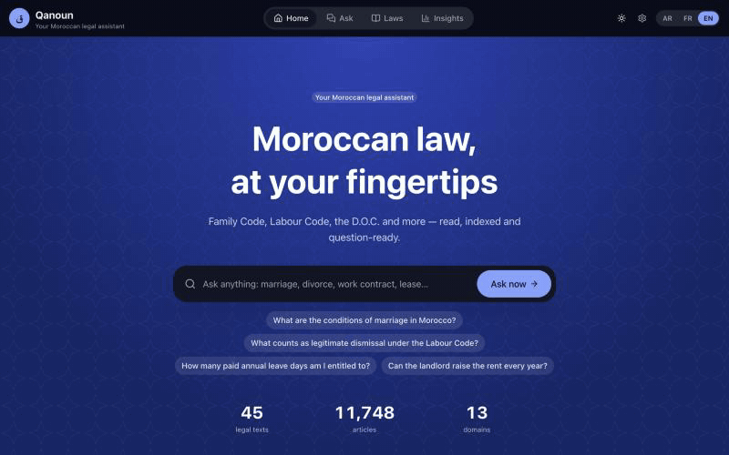

# قانون — Qanoun

**Moroccan laws, explored and question-ready.** Qanoun ingests the official texts of
Moroccan law (Family Code, Labour Code, the D.O.C., rental law…), structures them
article-by-article into Postgres/pgvector, and serves a trilingual (العربية RTL / Français /
English) web app where you can browse every article or ask questions in Darija, Arabic or
French — answered only from the retrieved sources, with citations to the exact article.

> المشروع يجمع هندسة البيانات والذكاء الاصطناعي في خدمة القانون المغربي: جلب النصوص الرسمية،
> هيكلتها إلى مواد، فهرستها دلاليا، ثم الإجابة عن الأسئلة (حتى بالدارجة) مع الإحالة إلى المادة.
>
> Ce projet combine data engineering, IA et droit marocain : ingestion des textes officiels,
> structuration en articles, indexation vectorielle et réponses sourcées.

**Informational only — not legal advice.** The official Bulletin remains the reference.

**Live demo: [qanoun-ma.vercel.app](https://qanoun-ma.vercel.app)**, on free tiers only: the web
app and the API on Vercel, the database on Supabase. To fit a serverless function, the demo
embeds with Jina's API instead of running BGE-M3; its retrieval scores are measured below.
The API's interactive documentation (Swagger UI) is at
[qanoun-api.vercel.app](https://qanoun-api.vercel.app).

<p align="center">
  
</p>
<p align="center"><sub>Ask in English, French, Arabic or Darija → answer with clickable citations → read the article, its amendments, and the whole law.</sub></p>

## The three layers

| Layer | What it does | Where |
|---|---|---|
| **Data engineering** | fetch (sha256-verified) → Arabic PDF parse + OCR fallback → article segmentation (footnote-glue repair, sub-numbers, sequence checks) → chunking → BGE-M3 embeddings → Postgres/pgvector | `pipeline/` |
| **AI** | hybrid retrieval (pgvector cosine + Arabic FTS, RRF fusion), Darija/Arabizi query rewriting via glossary + LLM, grounded answering with `[n]` citations and explicit abstention, streaming SSE | `backend/src/qanoun_api/rag/` |
| **Data science** | corpus EDA, keyword-domain classification experiments, embedding-space map, retrieval + LLM-as-judge evaluation | `notebooks/`, `backend/src/qanoun_api/eval/` |

## Quick start

Prerequisites: [uv](https://docs.astral.sh/uv/), Docker, Node 20+, and for the chat one
LLM: the quickest is a free [Google AI Studio key](https://aistudio.google.com/apikey) in
`.env` (`QANOUN_GEMINI_KEY=…`); OpenRouter, NVIDIA NIM, LM Studio and Ollama work too. Keys
stay on the server; the ⚙ dialog picks among configured providers, tests the connection, and
questions fall back automatically to the next model/provider when one is busy.

```bash
cp .env.example .env           # add QANOUN_GEMINI_KEY (or another provider)
make db                        # postgres + pgvector on :5433

make ingest                    # full pipeline: fetch → parse → structure → embed → load
# (no model download yet? `make ingest-smoke` proves the plumbing with hash embeddings)

make api                       # FastAPI on :8000
cd frontend && npm install && npm run dev   # Next.js on :3000
```

Open http://localhost:3000 → you land on `/ar` (RTL). Switch to FR/EN in the header.

### Try it

- **Ask**: «ما هي شروط الزواج؟», «شنو هي حالات الفصل المشروع؟», «Quels sont les cas de
  divorce ?» — answers cite `مدونة الأسرة — المادة 12` and deep-link into the reader.
- **Scope & AI**: under the question box, «Search in» limits answers to one domain or one law
  (type to filter), «AI» picks the provider; «Ask about this law» preselects the law.
- **Follow up**: «and for women?», «until what age?» — the conversation is taken into account.
- **Browse**: filter by domain (family, labour, housing…), read any law article-by-article.
- **Insights**: corpus statistics and keyword frequencies per domain.

## The corpus

Ingested from the Ministry of Justice's official legal portal ([adala.justice.gov.ma](https://adala.justice.gov.ma)),
**45 documents / 11,700+ articles across 13 domains**, each verified by sha256
(see `data/catalog/laws.yaml`):

| Domain | Laws (examples) |
|---|---|
| civil | قانون الالتزامات والعقود (D.O.C., ar+fr) |
| family | مدونة الأسرة (ar+fr), صندوق التكافل العائلي |
| penal | مجموعة القانون الجنائي (ar+fr), مكافحة غسل الأموال |
| justice | المسطرة المدنية (ar+fr), المسطرة الجنائية, التنظيم القضائي, قضاء القرب, المحاكم المالية |
| labour | مدونة الشغل (ar+fr), العمال المنزليين, حوادث الشغل |
| commercial | مدونة التجارة (ar+fr), شركات المساهمة, المنافسة, المقاول الذاتي, ميثاق الاستثمار (03.22) |
| education | التعليم العالي, التعليم المدرسي الخصوصي (06.00), دور الحضانة الخاصة |
| nationality | قانون الجنسية (ar+fr) |
| social | مدونة التأمينات |
| housing | القانون 67.12 المتعلق بالكراء, كراء المحلات التجارية |
| transport | مدونة السير على الطرق (52.05) |
| property | الحقوق العينية, التعمير, الملكية المشتركة, ظهير التحفيظ العقاري (1913, consolidated) |
| governance | الجمعيات, الصحافة والنشر, النقابات, حماية المعطيات الشخصية, الأوقاف, الأجانب, تحصيل الديون العمومية |

Bilingual laws carry both AR and FR editions as separate documents (`group` links them in
the UI). Scanned PDFs (الجنسية، الجمعيات، النقابات، التنظيم القضائي) are OCR'd
automatically at ingest. To add more laws: search the portal
(`adala.justice.gov.ma/search?term=…`), download the PDF into `data/raw/`, and add one YAML
entry — the pipeline handles fetch/verify/OCR/segmentation (`scripts/expand_catalog.py
--slugs …` adds candidates). Not on the portal as a law text (searched November 2026):
child *kafala* 15.01 (only a ministry circular), الحالة المدنية 37.10, مدونة التغطية الصحية
65.00, مدونة الانتخابات.

## Architecture


### Two flows, one database

1. **Ingest (offline, `make ingest`).** Each law in `data/catalog/laws.yaml` is downloaded from
   [adala.justice.gov.ma](https://adala.justice.gov.ma) and checked against its sha256. Text comes from the PDF text
   layer (PyMuPDF), falling back to Tesseract OCR (Arabic + French) for scanned pages. It is
   then split into articles using each law's own heading word (المادة / Article / الفصل),
   repaired (glued footnotes, sub-articles like `65-1` or `مكرر`), cut into 180-word passages
   with 40 words of overlap, embedded with BGE-M3 (1024 dimensions, cached by sha256) and
   loaded into Postgres. Every step re-derives from `data/raw/`, so re-running is always safe.
2. **Ask (online, per question).** The browser posts the question to `/api/chat`. FastAPI
   detects the variety (MSA, Darija, Arabizi, French) and, for dialect, rewrites it to MSA
   while the first search is already running. It embeds the question with the same BGE-M3
   model and runs **one SQL query with two channels**: cosine search over the HNSW vector
   index and Arabic-normalized full-text search. The two are fused with reciprocal rank
   fusion (and optionally reranked by a cross-encoder). The top articles go to the LLM as
   numbered sources, and the answer streams back over SSE (`meta → sources → token* → done`)
   with `[n]` citations — or an explicit «not found» when the sources don't answer.

### Tech stack

| Layer | Tools | What they do here |
|---|---|---|
| Data source | 🏛 [adala.justice.gov.ma](https://adala.justice.gov.ma) | Ministry of Justice portal: official consolidated texts (PDF) |
| Pipeline |     | fetch + sha256 check, PDF text, OCR fallback (ara + fra), article segmentation |
| Embeddings |     | 1024-dim multilingual vectors (strong on Arabic); optional `bge-reranker-v2-m3` cross-encoder |
| Database |   | laws / articles (`tsvector` GIN) / chunks (`vector(1024)` HNSW) + users, sessions, synced conversations |
| API |      | REST + SSE streaming, RAG, auth, rate limits, security headers |
| LLMs |      | any OpenAI-compatible provider; keys only in `.env`; automatic fallback across models and providers |
| Web app |        | trilingual UI (Arabic RTL, French, English), Ask workspace, law reader, insights, settings |
| Quality |     | offline tests (models faked), lint, strict typecheck, build on every push; retrieval + LLM-judge eval |
| Deploy |   | db · api · web containers with healthchecks; production override behind a TLS proxy |

### Repository layout

| Folder | Role |
|---|---|
| `data/catalog/laws.yaml` | the list of laws: slugs, sha256, official source URLs, per-law article words |
| `pipeline/` | fetch → parse (OCR fallback) → split into articles → chunk → embed → load; owns the DB schema |
| `backend/` | FastAPI: `/api/laws` (+ amendments), `/api/search`, `/api/chat` (SSE), `/api/auth`, `/api/conversations`, `/api/analytics`; RAG in `rag/`, eval in `eval/` |
| `frontend/` | Next.js 16 + HeroUI v3 + Tailwind 4 + next-intl (ar RTL default, fr, en) |
| `data/eval/`, `docs/eval-report.md` | question sets (law- and article-level), run history, latest report |
| `notebooks/` | EDA, classification, embedding map |
| `docker-compose*.yml` | local stack and production override |

More detail (design principles, retrieval SQL, prompt contract) in [docs/architecture.md](docs/architecture.md).

## Testing & evaluation

```bash
make test          # offline unit tests (models faked) + frontend typecheck and unit tests
make eval-retrieval  # questions searched as typed: hit@10 / MRR, no LLM (needs ingest)
make eval-rewrite  # + retrieval as /chat does it: Darija/Arabizi rewritten to MSA (needs an LLM)
make eval          # + grounded answers judged by an LLM; add a second provider as judge with
                   #   `python -m qanoun_api.eval.run --judge openrouter`
```

Three question sets, all scored on the full 45-document corpus, top 10, no reranker:

| question set | n | as typed: hit@10 / MRR | as /chat retrieves: hit@10 / MRR |
|---|---|---|---|
| seed, right law (`questions.jsonl`) | 26 | 0.962 / 0.798 | **1.000** / 0.869 |
| seed, exact article (`articles.jsonl`) | 36 | 0.833 / 0.668 | **0.917** / 0.689 |
| darija-rag set, an article on the labelled page (`pages.jsonl`) | 264 | 0.727 / 0.607 | **0.879** / 0.689 |
| darija-rag set, the article the reference answer cites | 260 | 0.704 / 0.575 | **0.850** / 0.650 |

"As /chat retrieves" searches the question and its MSA rewrite and merges both, which is
what users get. The darija-rag set by language, page-level hit@10:

| | MSA (117) | Darija (59) | Arabizi (31) | French (57) |
|---|---|---|---|---|
| as typed | 0.966 | 0.492 | 0.097 | 0.825 |
| as /chat retrieves | 0.966 | **0.831** | **0.742** | 0.825 |

**The live demo** embeds with `jina-embeddings-v3` instead of BGE-M3 (see Deploy). Measured
the same way ([report](docs/eval-report-demo.md)), it is close: page-level hit@10 0.894 as
/chat retrieves (Darija 0.864, Arabizi 0.774, MSA 0.940, French 0.895), cited article 0.869,
and on the seed sets 1.000 for the right law and 0.833 for the exact article.

The same questions scored 0.93 in [darija-rag](https://github.com/scorpionTaj/darija-rag)
(Darija 0.95, Arabizi 0.90), on 8 documents and with a reranker. Here they compete with 45
documents and no reranker; `scripts/port_darija_rag_eval.py` explains the port.

**Answers** (29 seed questions, generated by the default provider, graded by a different
one, OpenRouter): faithfulness 4.58, grounding 4.74, completeness 3.95 out of 5 over the 19
answers graded. 5 were answered but not graded (the judge failed), 2 out-of-scope probes
were correctly refused, and 3 abstention calls were wrong.

Every run appends to `data/eval/history.jsonl` and the report (`docs/eval-report.md`) shows
the trend, the per-language tables and the misses.

The opt-in reranker (`QANOUN_RERANKER=BAAI/bge-reranker-v2-m3`) was measured on the seed
sets, as typed, at an earlier commit: article-level hit@10 0.833 → 0.889, MRR 0.668 → 0.623.
It finds more right articles but ranks them lower on average and adds latency, so it stays
off by default.

## Common tasks

```bash
make ingest-smoke                      # full pipeline without the embedding model download
uv run --project pipeline python -m qanoun_pipeline.cli summary   # what's in the DB
docker compose up --build              # full stack in containers (api :8000, web :3000)
make user EMAIL=you@example.com        # create an account (asks for the password)
```

## Deploy

### Free demo: Vercel + Supabase

This is how [qanoun-ma.vercel.app](https://qanoun-ma.vercel.app) runs, at no cost:

- **Embeddings:** BGE-M3 is a 2 GB model, too large for a serverless function, so the demo
  uses Jina's `jina-embeddings-v3` API at 1024 dimensions (`QANOUN_EMBED_MODEL`), for both the
  passages and each question. The corpus was re-embedded once with
  [`scripts/reembed.py`](scripts/reembed.py) in about 12 minutes. (Gemini's free embedding
  tier was tried first; it allows 1,000 embeddings a day, two weeks for this corpus.)
- **Database:** a free Supabase project. The tables live in a `qanoun` schema, which
  Supabase's public Data API does not expose, owned by a dedicated `qanoun_api` role. The API
  connects through the IPv4 session pooler.
- **API:** a Vercel Python function in Paris (`cdg1`), built from
  [`deploy/vercel-api/`](deploy/vercel-api) with `QANOUN_DB_URL`, `QANOUN_JINA_KEY`, an LLM key
  (`QANOUN_GEMINI_KEY`), `QANOUN_EMBED_MODEL`, `QANOUN_CORS_ORIGINS`,
  `QANOUN_ALLOW_SIGNUP=false`, `QANOUN_REWRITE_CACHE=/tmp/rewrites.json` and, for the build,
  `UV_NO_EDITABLE=1`. PyMuPDF is left out of the function: only ingestion reads PDFs.
- **Web app:** a second Vercel project with `frontend/` as its root and `NEXT_PUBLIC_API_URL`
  pointing at the API.

Free-tier limits apply: Supabase pauses a project after a week without traffic (restore it
from the dashboard), Jina's free key covers a fixed number of tokens (each question uses a
few dozen), and Gemini's free tier limits answers per minute and per day.

### Your own server

Accounts are optional: without one, everything works and conversations stay in the browser.
Signed in, conversations sync to the server (newest copy wins).

1. On the server, copy `.env.example` to `.env` and set at least one LLM key plus:
   `POSTGRES_PASSWORD`, `QANOUN_PUBLIC_API_URL=https://api.your-domain`,
   `QANOUN_CORS_ORIGINS=https://your-domain`.
2. Start the stack: `docker compose -f docker-compose.yml -f docker-compose.prod.yml up -d --build`
   — the database is not exposed, API and web listen on 127.0.0.1 only, sign-up is closed,
   and the session cookie is HTTPS-only.
3. Put a TLS reverse proxy in front (Caddy: `your-domain { reverse_proxy localhost:3000 }`
   and `api.your-domain { reverse_proxy localhost:8000 }`). Keep both on one site
   (`example.com` + `api.example.com`) so the `SameSite=Lax` session cookie is sent.
4. Load the corpus once: `make ingest` against the production database, then create the first
   account (admin): `make user EMAIL=you@your-domain`.

Built in: per-IP rate limits (20 questions / min, 10 sign-in attempts / min; in memory, so
one API process), scrypt password hashing, httpOnly session cookies stored only as hashes, a
CSRF guard (JSON-only writes from allowed origins), security headers on API and web, and
container healthchecks.

## Status & roadmap

### Done (November 2026)

**Corpus & pipeline**
- [x] 45 documents · 11,748 articles · 13,880 indexed passages · 13 domains · 1913–2023
- [x] 7 laws in both Arabic and French (38 AR + 7 FR documents), linked as one law in the UI
- [x] sha256-verified fetch, OCR fallback for scanned PDFs, article segmentation with
      footnote/sub-article repair, BGE-M3 embeddings, Postgres/pgvector load

**Search & answers**
- [x] Hybrid retrieval (vectors + Arabic full-text, RRF fusion), scoped to a domain or a law
- [x] Darija / Arabizi detection and rewriting to MSA, run in parallel with the first search
- [x] Grounded answers with `[n]` citations to the exact article, explicit abstention
- [x] LLM providers configured in `.env` (Gemini, OpenRouter, NVIDIA NIM, LM Studio/Ollama):
      keys never reach the browser, `.env` changes apply without restart, current models
      picked from each provider's live list, automatic fallback across models and providers,
      busy / out-of-quota / unavailable models remembered and skipped
- [x] ~1.5 s per answer end to end with Gemini flash-lite (progress stages + timings shown)
- [x] Follow-up questions: recent turns are sent with each question; a follow-up («and for
      women?») is rewritten into a standalone question for search, and the answer prompt sees
      the conversation

**Web app** (Next.js 16 · React 19 · HeroUI v3 · Tailwind 4 · TypeScript 7)
- [x] Arabic (RTL) / French / English, light and dark Majorelle theme
- [x] Ask workspace: saved conversations (in the browser), clickable citations opening the
      full article beside the answer, Stop, mobile drawers
- [x] Composer controls: «Search in» (searchable list of 13 domains and 24 laws with article
      counts, Arabic-normalized filtering, one-click reset) and «AI» (Automatic or any
      provider configured in `.env`; unconfigured ones show the key they need)
- [x] Laws: one card per law with its editions, sticky filters; reader with Arabic-normalized
      in-law search, text size, deep links to `#article-N`, copy citation
- [x] Amendments: each law lists the amending texts named in its official footnotes, with
      links to the changed articles and an «Amended» badge on each
- [x] Print / save as PDF: an answer with its question, cited articles and disclaimer
- [x] Settings page: AI model, answer length and language, sources per answer, default
      search scope, export or delete conversations, optional account
- [x] Optional accounts (email + password) with conversations synced across devices
- [x] Insights: corpus statistics and keyword frequencies per domain
- [x] Phone layout with bottom tab bar; skip link, labelled controls, reduced-motion support

**Quality**
- [x] 81 backend + 47 pipeline + frontend unit tests (offline, models faked), ruff clean,
      strict typecheck
- [x] CI on every push / pull request: ruff, both test suites, typecheck, production build
      (`.github/workflows/ci.yml`)
- [x] Eval harness: 29 + 36 seed questions and the 264-question darija-rag set — hit@k / MRR
      per law, per article and per language, as typed and as /chat retrieves, run history,
      answers graded by a second provider
- [x] Opt-in cross-encoder reranker, measured against the eval before deciding

### Known limitations

- **Missing texts answer «not found»**: e.g. child *kafala* (law 15.01) is not on the portal
  as a law text, so such questions abstain rather than guess.
- **Homonyms** (كفالة = guarantee in the D.O.C. vs. child kafala) can pull the wrong articles
  unless the question is scoped to a domain or law.
- **Rate limits are per API process** (in memory). Running several API replicas needs the
  limit in the reverse proxy instead.
- **Amendments are what the footnotes say**, not point-in-time versions: the text shown is
  the current consolidated one, and a few footnotes name no article.
- **Dialect questions are still the weak spot**: with rewriting, Darija reaches 0.83 and
  Arabizi 0.74 page-level hit@10 against 0.97 for MSA; without it Arabizi is at 0.10.
- **Retrieval misses some short exact articles**: «and for a pregnant woman?» is understood
  correctly, but المادة 133 («تنتهي عدة الحامل بوضع حملها») ranks 20th. Tried and measured on
  `data/eval`: OR-ing keywords (alone, length-normalized, or as a third fused channel) lowers
  hit@10 from 0.923 to 0.846, so it was not shipped. The opt-in reranker raises article-level
  hit@10 (0.833 → 0.889) but not MRR.
- **Free cloud tiers** have daily per-model quotas; fallback absorbs them, heavy use needs a
  paid key or a local model.
- A few old or OCR'd PDFs carry digit / text-direction artifacts in their preambles.

### Roadmap

- [ ] Corpus: الحالة المدنية (37.10), مدونة التغطية الصحية (65.00), مدونة الانتخابات, child
      *kafala* (15.01) — when published as texts on the portal or another official source
- [ ] Reranker that improves MRR, not just hit@10 (fine-tune, or rerank only the top 10)
- [ ] Point-in-time versions of amended articles
- [ ] Password reset by email; publish Docker images from CI

Built by [scorpiontaj](https://github.com/scorpiontaj) — retrieval/eval patterns inherited
from [darija-rag](https://github.com/scorpiontaj/darija-rag).

## License

[AGPL-3.0](LICENSE), matching PyMuPDF, which the ingestion pipeline uses to read the PDFs.
The law texts are the Kingdom of Morocco's official publications.
