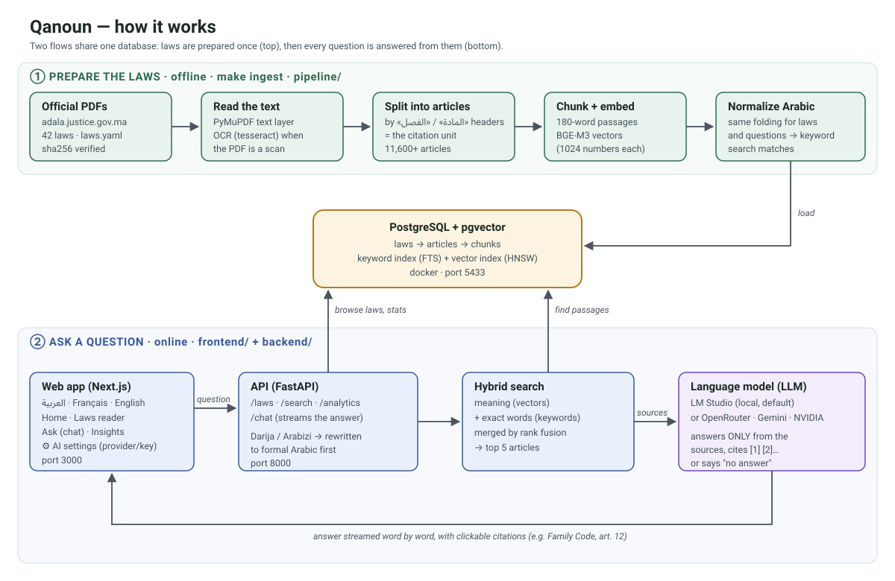

# قانون — Qanoun

**Moroccan laws, explored and question-ready.** Qanoun ingests the official texts of
Moroccan law (Family Code, Labour Code, the D.O.C., rental law…), structures them
article-by-article into Postgres/pgvector, and serves a trilingual (العربية RTL / Français /
English) web app where you can browse every article or ask questions in Darija, Arabic or
French — answered only from the retrieved sources, with citations to the exact article.

> المشروع يجمع هندسة البيانات والذكاء الاصطناعي في خدمة القانون المغربي: جلب النصوص الرسمية،
> هيكلتها إلى مواد، فهرستها دلاليا، ثم الإجابة عن الأسئلة (حتى بالدارجة) مع الإحالة إلى المادة.
>
> Ce projet combine data engineering, IA et droit marocain : ingestion des textes officiels,
> structuration en articles, indexation vectorielle et réponses sourcées.

**Informational only — not legal advice.** The official Bulletin remains the reference.

## The three layers

| Layer | What it does | Where |
|---|---|---|
| **Data engineering** | fetch (sha256-verified) → Arabic PDF parse + OCR fallback → article segmentation (footnote-glue repair, sub-numbers, sequence checks) → chunking → BGE-M3 embeddings → Postgres/pgvector | `pipeline/` |
| **AI** | hybrid retrieval (pgvector cosine + Arabic FTS, RRF fusion), Darija/Arabizi query rewriting via glossary + LLM, grounded answering with `[n]` citations and explicit abstention, streaming SSE | `backend/src/qanoun_api/rag/` |
| **Data science** | corpus EDA, keyword-domain classification experiments, embedding-space map, retrieval + LLM-as-judge evaluation | `notebooks/`, `backend/src/qanoun_api/eval/` |

## Quick start

Prerequisites: [uv](https://docs.astral.sh/uv/), Docker, Node 20+, and for the chat one
LLM: the quickest is a free [Google AI Studio key](https://aistudio.google.com/apikey) in
`.env` (`QANOUN_GEMINI_KEY=…`); OpenRouter, NVIDIA NIM, LM Studio and Ollama work too. Keys
stay on the server; the ⚙ dialog picks among configured providers, tests the connection, and
questions fall back automatically to the next model/provider when one is busy.

```bash
cp .env.example .env           # add QANOUN_GEMINI_KEY (or another provider)
make db                        # postgres + pgvector on :5433

make ingest                    # full pipeline: fetch → parse → structure → embed → load
# (no model download yet? `make ingest-smoke` proves the plumbing with hash embeddings)

make api                       # FastAPI on :8000
cd frontend && npm install && npm run dev   # Next.js on :3000
```

Open http://localhost:3000 → you land on `/ar` (RTL). Switch to FR/EN in the header.

### Try it

- **Ask**: «ما هي شروط الزواج؟», «شنو هي حالات الفصل المشروع؟», «Quels sont les cas de
  divorce ?» — answers cite `مدونة الأسرة — المادة 12` and deep-link into the reader.
- **Browse**: filter by domain (family, labour, housing…), read any law article-by-article.
- **Insights**: corpus statistics and keyword frequencies per domain.

## The corpus

Ingested from the Ministry of Justice's official legal portal ([adala.justice.gov.ma](https://adala.justice.gov.ma)),
**42 documents / 11,600+ articles across 13 domains**, each verified by sha256
(see `data/catalog/laws.yaml`):

| Domain | Laws (examples) |
|---|---|
| civil | قانون الالتزامات والعقود (D.O.C., ar+fr) |
| family | مدونة الأسرة (ar+fr), كفالة الأطفال المهملين, صندوق التكافل العائلي |
| penal | مجموعة القانون الجنائي (ar+fr), مكافحة غسل الأموال |
| justice | المسطرة المدنية (ar+fr), المسطرة الجنائية, التنظيم القضائي, قضاء القرب, المحاكم المالية |
| labour | مدونة الشغل (ar+fr), العمال المنزليين, حوادث الشغل |
| commercial | مدونة التجارة (ar+fr), شركات المساهمة, المنافسة, المقاول الذاتي |
| education | التعليم العالي, دور الحضانة الخاصة |
| nationality | قانون الجنسية (ar+fr) |
| social | مدونة التأمينات |
| housing | القانون 67.12 المتعلق بالكراء, كراء المحلات التجارية |
| transport | مدونة السير على الطرق (52.05) |
| property | الحقوق العينية, التعمير, الملكية المشتركة, التحفيظ العقاري* |
| governance | الجمعيات, الصحافة والنشر, النقابات, حماية المعطيات الشخصية, الأوقاف, الأجانب, تحصيل الديون العمومية |

Bilingual laws carry both AR and FR editions as separate documents (`group` links them in
the UI). Scanned PDFs (الجنسية، الجمعيات، النقابات، التنظيم القضائي) are OCR'd
automatically at ingest. To add more laws: search the portal
(`adala.justice.gov.ma/search?term=…`), download the PDF into `data/raw/`, and add one YAML
entry — the pipeline handles fetch/verify/OCR/segmentation. Still-wanted texts: الحالة
المدنية 37.10, التعليم الإجباري/الخصوصي (04.00/06.00), مدونة التغطية الصحية 65.00, ميثاق
الاستثمارات 03.22, مدونة الانتخابات.

\* التحفيظ العقاري entry currently holds the application decree; the 1913 dahir text is a
follow-up.

## Architecture



| Folder | Role |
|---|---|
| `data/catalog/laws.yaml` | the list of laws: slugs, sha256, official source URLs |
| `pipeline/` | fetch → parse (OCR fallback) → split into articles → chunk → embed → load |
| `backend/` | FastAPI: `/api/laws`, `/api/search`, `/api/chat` (SSE), `/api/analytics`; RAG in `rag/` |
| `frontend/` | Next.js 15 + Tailwind + next-intl (ar RTL default, fr, en) |
| `notebooks/`, `backend/.../eval/` | EDA, classification, embedding map, retrieval + LLM-judge eval |

More detail in [docs/architecture.md](docs/architecture.md).

## Testing & evaluation

```bash
make test          # offline unit tests (models faked) + frontend typecheck
make eval-retrieval  # hit@10 / MRR on data/eval/questions.jsonl (needs ingest)
make eval          # + grounded answers judged by the LLM (needs ingest + LLM)
```

The seed eval set covers MSA, Darija, Arabizi and French questions plus abstention probes.

## Common tasks

```bash
make ingest-smoke                      # full pipeline without the embedding model download
uv run --project pipeline python -m qanoun_pipeline.cli summary   # what's in the DB
docker compose up --build              # full stack in containers (api :8000, web :3000)
```

## Status & roadmap

- [x] Pipeline: 42/42 documents ingest (11.6k+ articles, 13 domains, 7 bilingual laws)
- [x] Hybrid retrieval + Darija rewriting + grounded streaming chat
- [x] Trilingual UI with RTL and citation deep-links
- [x] Eval harness + notebooks
- [ ] Grow corpus: الحالة المدنية, التعليم الإجباري/الخصوصي, التغطية الصحية, ميثاق الاستثمارات
- [ ] Retrieval reranker (cross-encoder) and answer quality eval dashboard
- [ ] Auth + saved conversations

Built by [scorpiontaj](https://github.com/scorpiontaj) — retrieval/eval patterns inherited
from [darija-rag](https://github.com/scorpiontaj/darija-rag).
