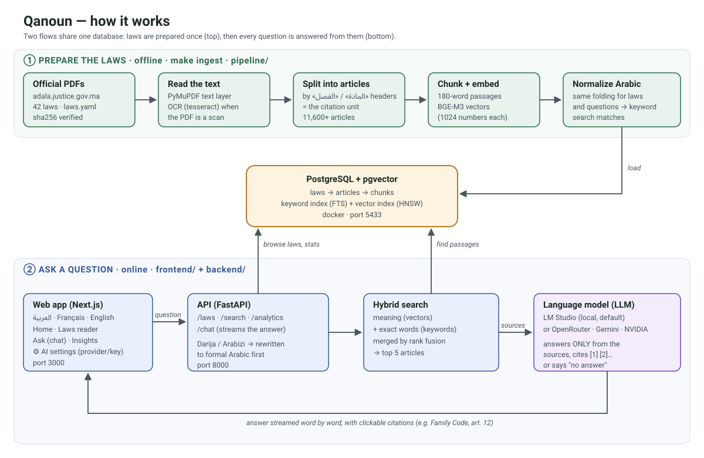

# Qanoun architecture



## Design principles

1. **The article is the citation unit.** Everything — search results, chat sources, reader
   anchors, eval expectations — resolves to `(law, article_number, page)`. Page-level RAG
   (as in darija-rag) cites pages nobody can verify quickly; article-level citations link
   straight to the text.
2. **The pipeline owns the schema.** `pipeline/schema.py` holds the DDL; the pipeline applies
   it idempotently on load and the API applies it at startup. One source of truth, no
   drift; Alembic becomes worthwhile when migrations (not creations) start happening.
3. **Index and query must normalize identically.** The same `normalize()` (diacritics,
   alef/ya/ta-marbuta folding, Arabic-Indic digits → ASCII) runs on documents before FTS
   indexing and on questions before FTS matching. Anything else silently kills recall.
4. **No LLM in the critical path except answering.** Retrieval works without any model
   configured; Darija rewriting is an optimization that degrades gracefully to the raw
   question; abstention is explicit, never a guessed legal answer.

## Data flow

```
adala.justice.gov.ma ──fetch (sha256)──▶ data/raw/*.pdf
        │
        parse.py      PyMuPDF text layer (line-structure preserving)
        │      └── StructureError or low article density ──▶ ocr.py (tesseract ara/fra, cached)
        ▼
structure.py   "المادة 12" / "Article 12" / D.O.C.'s "الفصل 12" ──▶ ArticleDraft[]
        │      repairs: glued footnotes ("Article 23" + note 17 → "2317"), sub-articles
        │      ("65-1", "65 مكرر"), duplicate-header dedup, sequence gap warnings
        ▼
chunk.py       180-word windows, 40 overlap, stable ids {law}#a{n}-c{i}
        ▼
embed.py       BGE-M3 (1024-dim), per-text sha256 cache in data/processed/embeddings/
        │      passage input carries context: "{title} — المادة {n}: {text}"
        ▼
load_db.py     laws / articles (normalized + tsvector GIN) / chunks (vector HNSW)
```

Every stage re-derives from `data/raw/`, so re-ingestion is always safe and additive.

## Retrieval

`rag/retrieval.py` runs one SQL statement with two channels over the same filters:

- **dense**: `embedding <=> query_vector` (cosine, HNSW-indexed), top-50
- **lexical**: `ts_rank(to_tsvector('simple', normalized), plainto_tsquery('simple', q))`, top-50

Both are fused with reciprocal rank fusion (`1/(60+rank)`), so a chunk found by both
channels wins without either channel's scale dominating. Darija questions are additionally
**rewritten to MSA** (glossary hints + LLM) and the fused result of both queries is merged
in Python — a bad rewrite can only add, never remove, hits.

## Answering

`rag/answer.py` prompts with numbered sources and a strict contract: answer only from the
sources, cite `[n]`, reply exactly `NO_ANSWER` when they don't contain the answer. The
router (`routers/chat.py`) streams SSE events:

```
meta → sources → token* → done
```

`done` carries `abstained` and the parsed citations, so the UI can highlight which
retrieved passages the model actually used, and deep-link each one to
`/ar/laws/{slug}#article-{number}`.

## Why these choices

- **Postgres for vectors** (pgvector HNSW) instead of a dedicated vector DB: the corpus is
  relational (laws → articles → chunks), filtering by domain/law happens in SQL anyway,
  and one database keeps the Docker story simple. FAISS/Chroma would be a second system
  to operate for no gain at this scale (~5k chunks; pgvector handles millions).
- **Reranker is opt-in.** `QANOUN_RERANKER=BAAI/bge-reranker-v2-m3` rescores the top 30
  fused hits with a cross-encoder. On `data/eval` it raises article-level hit@10 (0.833 →
  0.889) but lowers MRR (0.668 → 0.623) and adds latency, so it is off by default.
- **Article headers are per-law vocabulary.** The D.O.C. says "الفصل", everything else
  says "المادة". Hard-coding either breaks a law; the catalog carries `article_words`.
- **Percent-format notebooks** (`.py` with `# %%` cells): diffable in git, runnable as
  scripts (`uv run --with pandas ...`), and open as notebooks in VS Code/Jupytext.

## Local stack

| Service | Port | Notes |
|---|---|---|
| postgres (pgvector/pgvector:pg17) | 5433 | user/db `qanoun` |
| FastAPI | 8000 | `make api`, docs at /docs |
| Next.js | 3000 | `make web`, `/ar` default |
| LLM (host, not containerized) | 1234 | LM Studio/Ollama, `QANOUN_LLM_URL` |

`docker compose up --build` runs the three containers; the LLM stays on the host
(`host.docker.internal`), which keeps MLX/GPU access simple.
